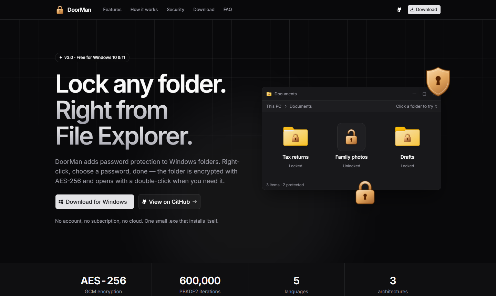

<div align="center">

<br />



<br />
<br />

<picture>
  <source media="(prefers-color-scheme: dark)" srcset="https://img.shields.io/badge/DoorMan-usedrmn.vercel.app-FAFAFA?style=for-the-badge&logoColor=080808&labelColor=FAFAFA">
  
</picture>

<br />
<br />

**Password protection for Windows 10/11 folders, built into File Explorer.**  
DoorMan encrypts a folder's contents and asks for the password *before* anything inside can be seen or opened,
whether from Explorer or from any other app.

<br />

[](https://usedrmn.vercel.app)
[](https://github.com/cristhobal/drmn/releases/latest)
[](#download-and-install)
[](#download-and-install)
[](https://dotnet.microsoft.com)
[](#how-it-works)
[](#how-it-works)

<br />

</div>

---

## Features

- **Built into File Explorer** — protect, open and lock folders from the right-click menu, including the Windows 11
  modern menu
- **Real encryption** — the contents are packed and encrypted with AES-256-GCM; the key is derived from your password
  with PBKDF2-SHA256 (600,000 iterations)
- **Guarded from every app** — opening a file of a locked folder from anywhere (recent files, jump lists, the command
  line…) asks for the password first
- **Safe by design** — the encrypted copy is verified (SHA-256 of every file) before any original is removed
- **Native look** — locked folders get a padlock icon in the style of Windows 10 or 11
- **5 languages** — English, Spanish, French, Chinese (Simplified) and Hindi, following the Windows display language
  (falls back to English)
- **Single self-installing exe** — .NET included, per-user install, no account and no internet needed

---

## Download and install

Get the file for your PC from the [latest release](https://github.com/cristhobal/drmn/releases/latest), or from
[usedrmn.vercel.app](https://usedrmn.vercel.app):

| Your Windows | File |
|---|---|
| Windows 11 or 64-bit Windows 10 (most PCs) | `DoorMan-x64.exe` |
| Windows 11 or Windows 10 on ARM (Snapdragon, etc.) | `DoorMan-arm64.exe` |
| 32-bit Windows 10 | `DoorMan-x86.exe` |

Not sure? Open **Settings → System → About** and look at **System type**. If you pick the wrong file, DoorMan tells
you which one to download.

1. Double-click the downloaded file and choose **Install**. Nothing else is needed (.NET is included).
2. On Windows 11, Windows asks once for permission (UAC) to add DoorMan to the context menu. If you decline, the
   options stay under **Show more options**.
3. Done. DoorMan installs for your user only, in `%LOCALAPPDATA%\Programs\DoorMan`, and starts silently with Windows.
   Uninstall it from **Settings → Apps**.

> [!NOTE]
> The executable is not code-signed, so Windows SmartScreen may warn that it is an unrecognized app: choose
> **More info → Run anyway**.

---

## Usage

| Step | What to do |
|---|---|
| **Protect** | Right-click a folder → **Protect with password**. Enter and confirm the password. |
| **Open** | Open the locked folder as usual (double-click). DoorMan asks for the password first; once it is correct, the folder is decrypted and Explorer goes straight into it. A wrong password lets you try again. |
| **Open a file directly** | Opening a file of a locked folder from anywhere else (recent files, an app's jump list, the command line…) also asks for the password; when it is correct, the folder is unlocked and the app gets the file. |
| **Lock** | When you are done, right-click the folder → **Lock**. It is locked again with the same password. |

The context menu adapts to each folder: unprotected folders show **Protect with password**, locked folders show
**Unlock** and unlocked ones show **Lock**. Locked folders show a padlock icon (empty or with content); unlocked
folders keep the normal Windows folder icon. Errors are reported with a native Windows notification. On Windows 11,
**Unlock** is under **Show more options**: Windows shows no packaged commands on locked folders (double-clicking them
asks for the password anyway).

---

## How it works

| Piece | Details |
|---|---|
| Encryption | All contents (files, subfolders, attributes and timestamps) are packed into a single hidden file, `Unlock folder.doorman`, encrypted with AES-256-GCM in 1 MiB chunks. |
| Key derivation | PBKDF2-SHA256 with 600,000 iterations and a random salt; every lock derives a fresh content key with HKDF. |
| Placeholders | Locked files are Windows Cloud Files placeholders with no content. |
| Background agent | `DoorMan.exe --agent`, started at sign-in, serves file requests and context menu commands. |
| Explorer extension | `DoorManShell.dll`, a native C++ `IShellFolder2`, asks for the password before Explorer opens a locked folder. |
| Windows 11 menu | A sparse MSIX package declares an `IExplorerCommand` so the options appear in the modern context menu. |
| Relocking | While a folder is unlocked, its key is kept with DPAPI and deleted when the folder is locked again. |

- **Placeholders.** A locked folder is registered as a sync root with the Windows Cloud Files API (the mechanism behind
  OneDrive Files On-Demand). Every file is left as a placeholder with its name, size and dates but **no content**: the
  data only exists in the encrypted file. When any app tries to read a placeholder, Windows asks DoorMan for the data,
  DoorMan asks for the password, unlocks the folder and hands the file over. If the volume does not support
  placeholders (not NTFS, network drives…), the originals are deleted instead and the folder only holds the encrypted
  file.
- **Background agent.** `DoorMan.exe --agent` (started at sign-in) serves those requests and runs the context menu
  commands, which reach it through a named pipe restricted to the current user. Without it, apps opening a locked file
  get "the cloud file provider is not running" and the content stays encrypted.
- **Data safety.** The encrypted file is fully written and decrypted again to verify it (SHA-256 of every file)
  *before* any original is removed. Unlocking decrypts everything into a hidden staging folder first; if that fails,
  the folder stays locked and untouched.
- **Explorer extension.** The `desktop.ini` of a locked folder points to `DoorManShell.dll`, so when Explorer tries to
  open the folder the extension cancels the navigation and asks for the password instead. Once unlocked, it forwards
  everything to the regular file system folder. Quick Access entries are refreshed when locking so they also go through
  the extension.
- **Relocking.** While a folder is unlocked, its key is stored protected with DPAPI (readable only by your Windows user)
  in `%LOCALAPPDATA%\DoorMan`. It is deleted when the folder is locked again.
- **Context menu.** Menu entries are filtered per folder with `AppliesTo` on `System.ParsingPath` (the real path, not the
  localized display path). DoorMan never changes the default double-click action of folders.
- **Windows 11 context menu.** The modern menu only shows commands of apps with package identity, so DoorMan installs a
  sparse package (`DoorMan.msix`, pointing to the install folder) that declares an `IExplorerCommand` from
  `DoorManShell.dll`. It shows **Protect with password** or **Lock** depending on the folder (unlocked folders are
  listed in `%LOCALAPPDATA%\DoorMan\unlocked.txt`), and replaces the registry entries. Windows only installs it if
  signed with a machine-trusted certificate: each build creates a new self-signed one, signs the package and destroys
  the private key right away; the installer trusts the certificate (UAC) and removes those of previous builds.
- **Single-file installer.** Each `DoorMan-<arch>.exe` is a self-contained .NET app that carries the Explorer extension
  for its architecture, the icons and the Windows 11 package as embedded resources, and extracts them when installing.

---

## Tech stack

| Layer | Technology |
|---|---|
| App | C# · [.NET 10](https://dotnet.microsoft.com) · WinForms, self-contained single file |
| Explorer extension | C++ · Win32 / COM (`IShellFolder2`, `IExplorerCommand`) |
| Encryption | `System.Security.Cryptography` — AES-GCM, PBKDF2, HKDF, DPAPI |
| File access | Windows Cloud Files API (sync root + placeholders) |
| Windows 11 menu | Sparse MSIX package with a self-signed certificate |
| Testing | xUnit |
| Architectures | x64 · ARM64 · x86 |

---

## Architecture

```
/
├── src/DoorMan/
│   ├── Program.cs                      # Entry point: install, agent and command-line dispatch
│   ├── Commands.cs                     # --protect / --open / --lock and legacy argument mapping
│   ├── Strings.cs                      # Every user-facing text, in 5 languages
│   │
│   ├── Agent/
│   │   ├── AgentHost.cs                # Background process started at sign-in (named pipe)
│   │   └── CloudProvider.cs            # Cloud Files sync root: serves placeholder data on demand
│   │
│   ├── Core/
│   │   ├── FolderLocker.cs             # Lock / unlock workflow, verification and staging
│   │   ├── FolderArchive.cs            # Packs a folder (files, attributes, timestamps)
│   │   ├── FolderRules.cs              # Which folders can be protected
│   │   ├── CloudFiles.cs               # Cloud Files API helpers
│   │   ├── AppState.cs                 # %LOCALAPPDATA%\DoorMan state and DPAPI-protected keys
│   │   └── Support.cs
│   │
│   ├── Crypto/
│   │   ├── KeyMaterial.cs              # PBKDF2 key envelope
│   │   ├── VaultFile.cs                # Vault header and HKDF content key
│   │   └── ChunkedStreams.cs           # AES-256-GCM in 1 MiB authenticated chunks
│   │
│   ├── Shell/
│   │   ├── Installer.cs                # Per-user install, update and uninstall
│   │   ├── ShellIntegration.cs         # Context menu verbs and folder icons
│   │   ├── ContextMenuPackage.cs       # Windows 11 sparse package and certificate
│   │   └── …                           # Explorer windows, Quick Access, embedded payload
│   │
│   └── UI/                             # Password, progress and main dialogs, notifications
│
├── native/DoorManShell/
│   ├── DoorManShell.cpp                # IShellFolder2 + IExplorerCommand extension
│   └── package/AppxManifest.xml        # Sparse package manifest ($ARCH$ per build)
│
├── icons/                              # Padlock and locked-folder icons (Windows 10 and 11 styles)
└── tests/DoorMan.Tests/                # Unit tests
```

---

## Limitations

- If you forget the password, the contents **cannot be recovered**.
- While a folder is locked, file **names, sizes and dates remain visible** (the content does not).
- Files that are open in another app when locking keep their content until they are closed; DoorMan empties them then.
- Originals are removed normally; on hard disk drives, forensic tools might recover remnants. For maximum security, also
  use BitLocker.
- Drive roots, system folders, the user profile and whole personal folders (Desktop, Documents…) cannot be protected,
  nor folders with symbolic links or OneDrive files that are not downloaded.
- Custom NTFS permissions and alternate data streams are not preserved.
- If a folder is moved or renamed while unlocked, locking it again asks for a new password.
- A new version of the Explorer extension is loaded after Explorer restarts (or after signing out).

---

## Development

### Prerequisites

- .NET 10 SDK
- Visual Studio C++ build tools (x64, x86 and ARM64)
- Windows SDK (`makeappx`, `signtool`)

```powershell
dotnet test tests\DoorMan.Tests   # unit tests
```

The build and packaging scripts (icons, native extension, signed MSIX) are kept out of this repository.

### Adding a language

User-facing texts live in `src/DoorMan/Strings.cs` (and the three Windows 11 menu titles in
`native/DoorManShell/DoorManShell.cpp`); to add a language, add a value to `Language` and a translation to each entry.

### Command-line arguments

| Argument | Description |
|---|---|
| `--protect <folder>` | Protect a folder with a password |
| `--open <folder>` | Unlock and open a protected folder |
| `--lock <folder>` | Lock an unlocked folder again |
| `--install` / `--uninstall` | Install or remove DoorMan for the current user |
| `--register` / `--unregister` | Add or remove the Explorer integration |
| `--startup` / `--agent` | Start the background agent (at sign-in / directly) |

---

<div align="center">

Made by [Cristhobal Canales](https://www.cristhobal.cl) · [usedrmn.vercel.app](https://usedrmn.vercel.app)

</div>
